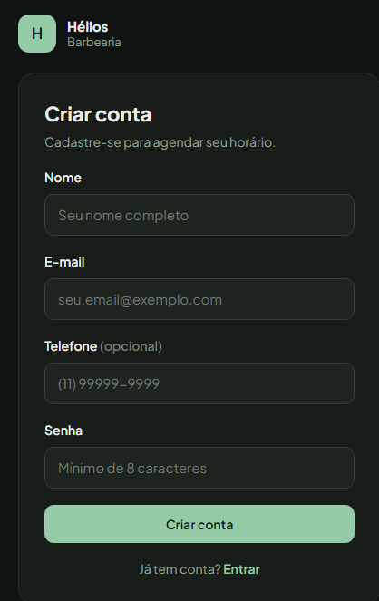
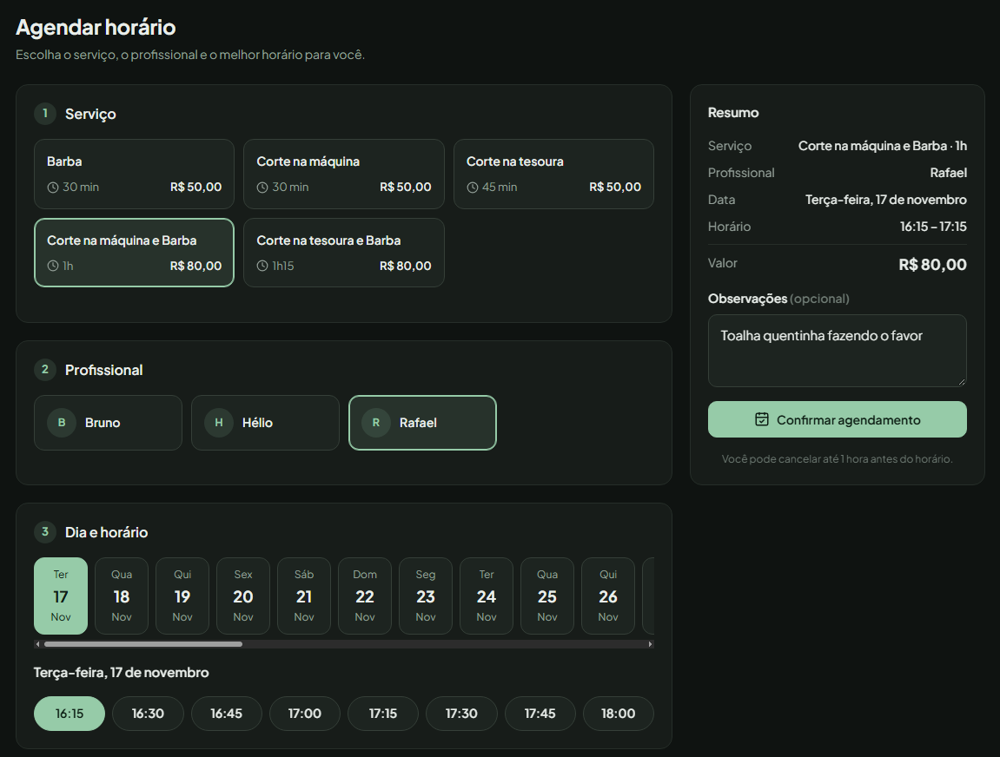
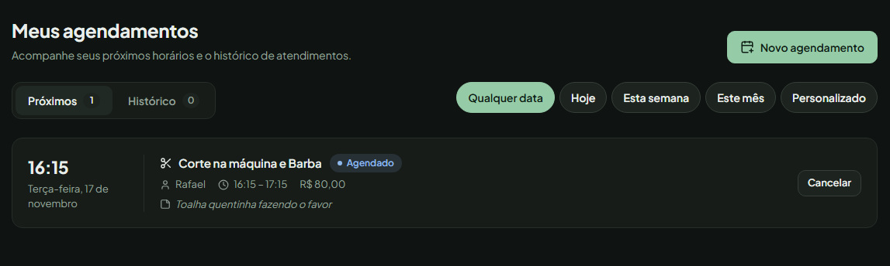
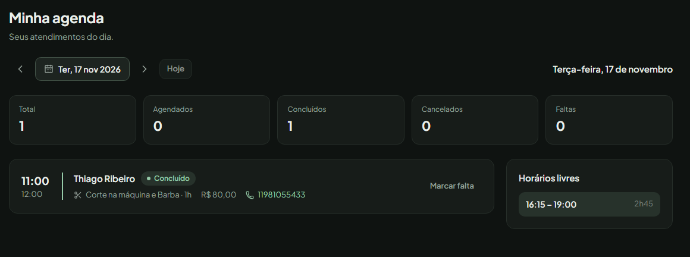
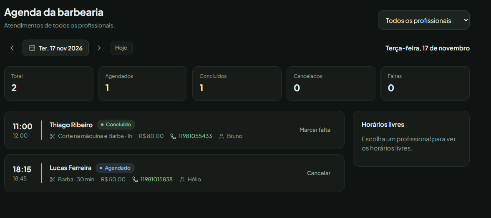
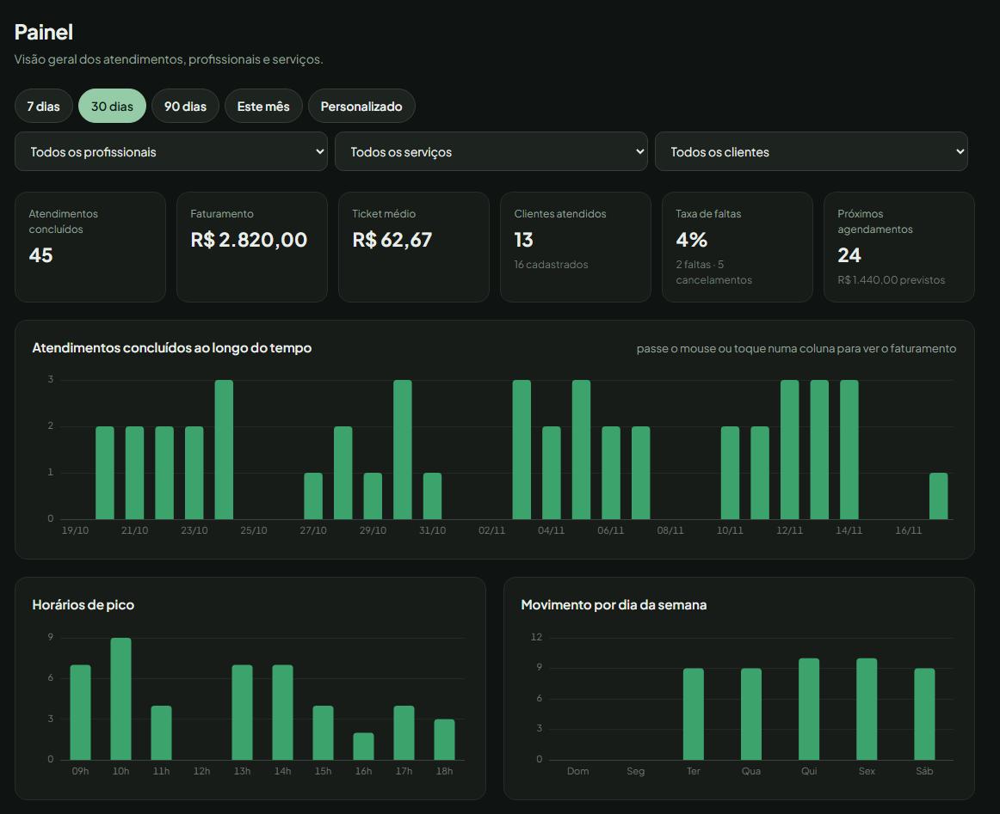
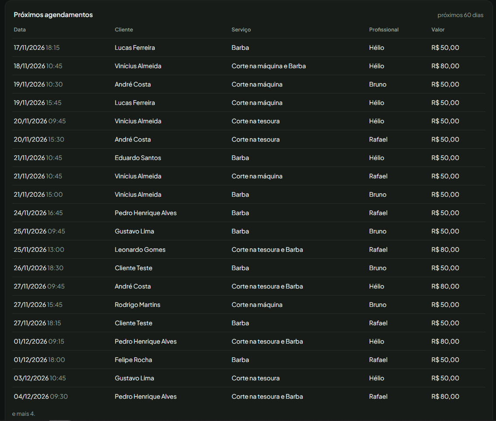
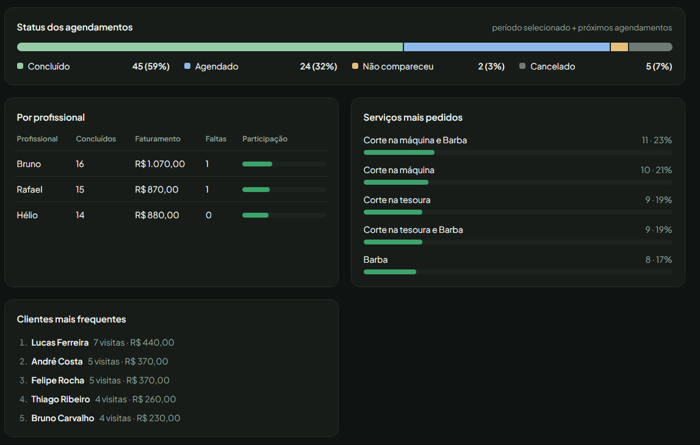
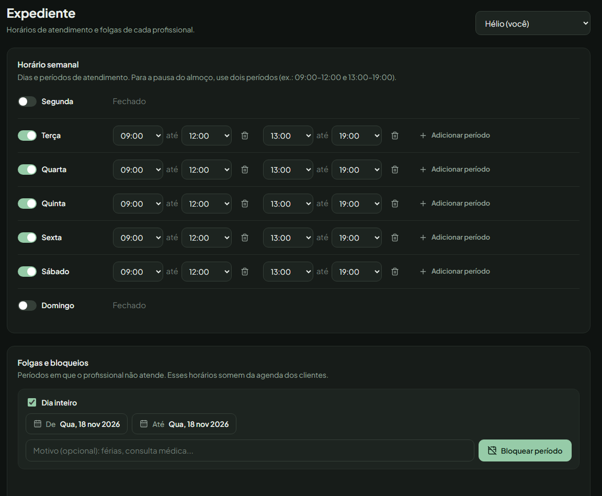
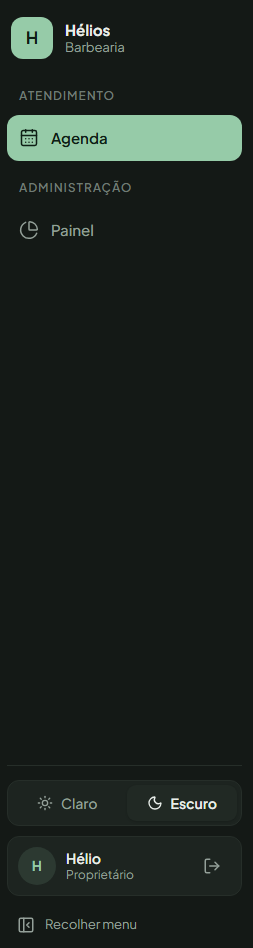

# Barbearia Hélios

Sistema de agendamento da Barbearia Hélios.

- **Clientes:** se cadastram, escolhem serviço, profissional e horário, e acompanham os próprios agendamentos.
- **Barbeiros:** veem a agenda do dia, dão baixa nos atendimentos e cadastram as próprias folgas.
- **Dono:** acompanha a agenda de todos, define o expediente de cada profissional e tem um painel com faturamento, horários de pico e desempenho por profissional.

## Telas

### Cliente

| Criar conta / entrar | Agendar horário |
|---|---|
|  |  |

**Meus agendamentos:** próximos horários e histórico, com filtro de período e cancelamento até 1h antes.



### Barbeiro

**Minha agenda:** atendimentos do dia, horários livres e baixa (concluído / não compareceu).



### Dono

**Agenda da barbearia:** atendimentos de todos os profissionais, com filtro por profissional.



**Painel:** indicadores do período, atendimentos ao longo do tempo, horários de pico e movimento por dia da semana. Tudo responde aos filtros de período, profissional, serviço e cliente.



**Próximos agendamentos**



**Status dos agendamentos, desempenho por profissional, serviços mais pedidos e clientes frequentes**



**Expediente:** horário semanal e folgas de cada profissional.

- **Horário semanal:** o dono escolhe o profissional, liga ou desliga cada dia e define um ou mais períodos de atendimento, de 15 em 15 minutos. A pausa do almoço é o espaço entre dois períodos (ex.: 09:00–12:00 e 13:00–19:00). A tela impede períodos sobrepostos ou com início depois do fim, e as mudanças valem na hora para os horários oferecidos aos clientes.
- **Folgas e bloqueios:** um ou mais dias inteiros, ou parte de um dia, com motivo opcional (férias, consulta médica...). O período some da agenda dos clientes. Se já houver cliente marcado nele, o bloqueio é recusado e a tela mostra quais horários precisam ser cancelados ou remarcados antes.
- **Permissões:** o dono gerencia o expediente e as folgas de todos. O barbeiro vê o próprio expediente, só para leitura, e cadastra as próprias folgas.



### Navegação



**Sidebar retrátil:** os itens mudam conforme o papel (cliente, barbeiro ou dono). No celular, ela vira uma gaveta. Também tem a troca de tema claro/escuro e o botão de sair.

<br clear="left" />

| Pasta / arquivo | O que é |
|---|---|
| [`backend/`](backend/) | API REST em Node.js, Express, TypeScript, PostgreSQL e Prisma |
| [`frontend/`](frontend/) | Aplicação web em React, TypeScript e Vite, servida por nginx em produção |
| `docker-compose.yml` | Postgres, API e frontend |

## Rodando com Docker (tudo junto)

Pré-requisito: Docker com Compose.

```bash
cp .env.example .env     # preencha JWT_ACCESS_SECRET e JWT_REFRESH_SECRET
docker compose up -d --build
```

O app abre em **http://localhost:8080**.

Na primeira vez, popule o banco com os dados de exemplo (serviços, barbeiros, cliente de teste):

```bash
docker compose exec api npm run seed:prod
```

Como funciona:

| Serviço | Imagem | O que faz |
|---|---|---|
| `postgres` | `postgres:17-alpine` | Banco, com volume `pgdata`. Publicado em `5432` para o desenvolvimento local |
| `api` | `backend/Dockerfile` | Aplica as migrations pendentes ao subir e inicia a API. **Não publica porta**: o acesso é pelo nginx |
| `web` | `frontend/Dockerfile` | nginx servindo o build do React e repassando `/api/*` para a API |

- **Mesma origem:** o navegador acessa tudo em `localhost:8080` (o app em `/` e a API em `/api`). Por isso não há CORS, e o cookie de refresh usa `Path=/api/auth`.
- **HTTPS:** sem HTTPS na frente, o cookie vai sem `Secure` (`COOKIE_SECURE=false`). Ao publicar atrás de HTTPS, use `COOKIE_SECURE=true` e ajuste `APP_URL`.
- **Insomnia contra o Docker:** use `base_url = http://localhost:8080/api`.

Comandos úteis:

```bash
docker compose logs -f api            # logs da API
docker compose ps                     # estado e health checks
docker compose down                   # para tudo (os dados ficam no volume)
docker compose down -v                # para e APAGA o banco
```

## Desenvolvimento local (sem Docker para API e frontend)

```bash
docker compose up -d postgres                                                        # só o banco
cd backend && npm install && npm run db:migrate && npm run db:seed && npm run dev    # API em http://localhost:3333
cd frontend && npm install && npm run dev                                            # web em http://localhost:5173
```

Detalhes da API (rotas, regras de agendamento, usuários do seed, coleção do Insomnia) estão em [`backend/README.md`](backend/README.md). Detalhes do frontend estão em [`frontend/README.md`](frontend/README.md).
